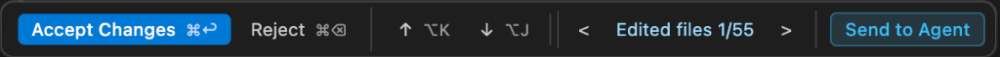
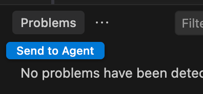

# Antigravity Accept & Reject Floating Buttons

A clean, minimalist floating review capsule bar for **Google Antigravity IDE** and **VS Code**. Restores the iconic floating review toolbar (`Accept Changes ⌘↩` · `Reject ⌘⌫` · `↑ ⌥K` · `↓ ⌥J` · `< Edited files X/Y >` · `Send to Agent`) with keyboard shortcuts and multi-file navigation.



---

## Features

- **In-Editor Floating Capsule Bar**: Floats directly inside the active Monaco code editor at the bottom viewport, mirroring Antigravity's native Cascade review UI.
- **Accept Changes (`⌘↩` / `Ctrl+Enter`)**: Instantly accepts pending agent edits or stages modified hunks.
- **Reject Changes (`⌘⌫` / `Ctrl+Backspace`)**: Reverts uncommitted changes cleanly.
- **Previous Hunk (`⌥K` / `Alt+K`)**: Jumps smoothly to the previous diff hunk in the active editor.
- **Next Hunk (`⌥J` / `Alt+J`)**: Jumps smoothly to the next diff hunk in the active editor.
- **File Navigation (`< Edited files X/Y >`)**: Rapidly cycle across all modified files in the workspace.
- **Send to Agent (`@current_problems`)**: One-click diagnostics bridge that collects all active workspace errors and pre-fills them in the Agent Chat panel without needing screenshots.
- **Zero Distraction**: Auto-hides when working in clean workspaces with no pending diffs.
- **Dual Mode**: Interoperates with Antigravity Agent internal commands, inline diffs, and standard Git diff workflows.

---

## Send to Agent Diagnostics Bridge



A dedicated one-click diagnostics bridge available directly inside the Problems panel toolbar and floating review capsule:
- **Instant Diagnostics Capture**: Automatically scans all active workspace compilation errors, syntax warnings, and file locations.
- **Clipboard & Chat Integration**: Formats the diagnostic output cleanly as an `@current_problems` block and copies it to your clipboard.
- **Zero Screenshot Hassle**: Pre-fills the formatted errors directly into the Antigravity Agent Chat input so you never need to take manual error screenshots.

---

## Keyboard Shortcuts

| Action | macOS Shortcut | Windows / Linux Shortcut |
| :--- | :--- | :--- |
| **Accept Changes** | `⌘ + Enter` | `Ctrl + Enter` |
| **Reject Changes** | `⌘ + Backspace` | `Ctrl + Backspace` |
| **Previous Hunk** | `⌥ + K` | `Alt + K` |
| **Next Hunk** | `⌥ + J` | `Alt + J` |
| **Previous File** | `Click <` | `Click <` |
| **Next File** | `Click >` | `Click >` |

---

## Configuration Settings

You can customize the extension via VS Code / Antigravity Settings (`Cmd + ,` or `Ctrl + ,`):

| Setting | Type | Default | Description |
| :--- | :--- | :--- | :--- |
| `antigravityFloatingDiff.enabled` | `boolean` | `true` | Master switch to enable or disable the floating review capsule bar and diff enhancements. |
| `antigravityFloatingDiff.showReviewBar` | `boolean` | `true` | Display the floating capsule review bar inside the active code editor viewport. |
| `antigravityFloatingDiff.showDeletedLines` | `boolean` | `true` | Display deleted code with inline red lines directly in the main code file. |
| `antigravityFloatingDiff.position` | `string` | `"bottom-center"` | Placement of the review bar (`"bottom-center"`, `"bottom-right"`, or `"status-bar"`). |
| `antigravityFloatingDiff.autoHideWhenClean` | `boolean` | `true` | Automatically hide the floating bar when there are no modified files or hunks. |
| `antigravityFloatingDiff.showFileNavigation` | `boolean` | `true` | Show the multi-file navigation section (`< Edited files X/Y >`) in the floating bar. |
| `antigravityFloatingDiff.enableStatusBarFallback` | `boolean` | `true` | Display status bar review items as an additional fallback in the bottom status line. |

---

## Installation

### From Source
```bash
git clone https://github.com/Ashish-Akm/Antigravity_accept-rejectButtons.git
cd Antigravity_accept-rejectButtons
npm install
npm run build
```

The extension bundle compiles to `dist/extension.js` and can be loaded directly in Antigravity IDE or VS Code.

---

## Author
- Developed by: Ashish Kumar Mahto
- Repository: [https://github.com/Ashish-Akm/Antigravity_accept-rejectButtons](https://github.com/Ashish-Akm/Antigravity_accept-rejectButtons)
- License: MIT
